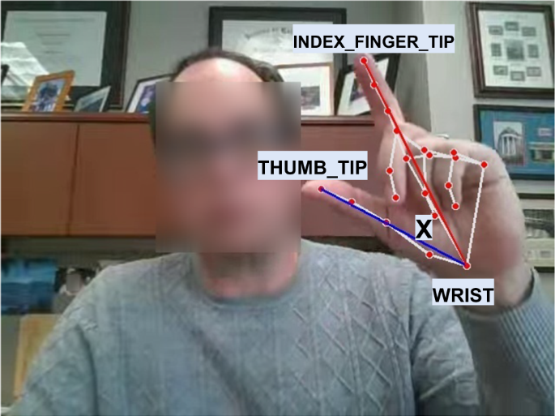

# Parkinson's Disease Detection

Parkinson's disease (PD) is a neurological disorder that can affect a person's movement and voice. Two symptoms we are interested in are **bradykinesia**, which refers to slowness of movement and can be assessed through repetitive movements such as finger tapping, and **vocal changes**, which can be captured through sustained vowel recordings.

A lot of existing research uses computer vision or machine learning to detect Parkinson's from movement or voice data. However, many approaches ultimately try to answer a pretty simple question: **Does this person have Parkinson's or not?**

That's not quite what we're interested in.

Instead, we want to explore how effectively classical machine learning and deep learning can use **finger-tapping video and vocal recordings** to support Parkinson's assessment, **while also communicating how uncertain the model is about its predictions.** Basically, we're asking whether we can build models that don't just give an answer, but also tell us how much we should trust that answer, and flag unreliable predictions for clinician review.

This gives us two sides to the project:
- **Technical**: Build and evaluate models for two complementary data modalities, rather than forcing the same architecture onto both.
- **Research/ethics**: Investigate what it actually means to use a system like this in a clinical setting, including uncertainty, bias, explainability, and when the system should defer to a clinician.

The intended system is **not an autonomous diagnostic tool**. It is a research framework for clinician-supervised Parkinson's assessment.

## Two tracks

We select approaches based on the data available for each modality, investigate the strengths and limitations of each, and evaluate how reliably the models make predictions. The two tracks are initially modeled and evaluated independently because their datasets differ in sample size, input format, and potentially prediction target.

### Track One: Finger-tapping video

Finger tapping is a simple and repeatable movement that can reveal differences in motor function. We use computer vision (OpenCV and MediaPipe Hand Landmarker) to track 21 hand landmarks in monocular video, and use the thumb tip and index fingertip to estimate finger separation over time.

Things we can potentially measure include:

- Tapping frequency and total tap count
- Movement amplitude (mean and maximum)
- Amplitude variability and decrement over time
- Inter-tap intervals and timing variability
- Movement velocity and acceleration
- Differences between hands (where paired recordings and suitable labels exist)
- Tracking quality and the proportion of missing landmarks

The dataset contains approximately 234 videos from a smaller number of unique participants (left- and right-hand recordings may come from the same person). Because of the limited sample size, we prioritize **interpretable features and classical machine learning** (e.g. Logistic Regression, Random Forest, XGBoost/LightGBM, ordinal regression) rather than a complex temporal deep learning model.

The prediction target depends on the available labels: motor severity estimation if hand-specific or task-specific clinical scores exist, otherwise Parkinson's classification. All videos from the same participant must stay in the same data split.

### Track Two: Vocal analysis

The vocal dataset contains recordings from **1,000 unique participants** (about 500 with PD and 500 controls) performing sustained vowel phonations such as /a/. A separate or associated 100-participant subset contains demographic information such as age and gender.

The initial task is **binary Parkinson's disease classification**. We compare:

- **Classical ML** on engineered acoustic features (MFCCs, fundamental frequency, jitter, shimmer, harmonic-to-noise ratio, eGeMAPS, etc., extracted with tools like openSMILE and librosa), using models such as Logistic Regression, SVM, Random Forest, and XGBoost/LightGBM
- **A spectrogram-based CNN** trained on log-Mel spectrograms
- **Pretrained audio representations** (e.g. wav2vec 2.0) with a classification head, as an optional extension

Before modeling, we audit the dataset: the source and meaning of the diagnostic labels, recordings per participant, audio quality and collection procedures, and whether the demographic subset overlaps with the main dataset. We do not assume the 100-person subset is an independent test cohort, and we do not assume a diagnostic label can tell us disease severity.

## Why are we doing this?
Medical AI can produce impressive predictions, but a prediction by itself does not tell us whether the system should be trusted.

A model might perform well on the data it was trained on but behave differently when:

- The lighting changes
- The camera is positioned differently
- A hand is partially obstructed
- The video quality is lower
- The microphone or recording device is different
- There is background noise
- The person looks or sounds different from the training population

Uncertainty is particularly important for our project. If a model is highly uncertain about a particular assessment, that could be a situation where the system should defer to a clinician rather than provide a confident-looking answer. We also distinguish between a model's confidence and whether its prediction is actually correct, since high confidence alone does not establish reliability.

## What do we investigate?

- **Predictive performance**: How informative are interpretable movement and acoustic features? Does deep learning improve vocal classification over classical ML?
- **Uncertainty**: Can calibration, bootstrapping, deep ensembles, Monte Carlo dropout, or conformal prediction identify unreliable predictions and support a deferral mechanism?
- **Robustness**: How do recording conditions and distribution shift affect performance and uncertainty?
- **Explainability**: Which features or spectrogram regions drive predictions? We treat findings as hypotheses, not clinically validated biomarkers.
- **Fairness**: Do performance, calibration, and deferral rates differ across demographic groups, where sample sizes permit?
- **Human oversight**: How could these models fit into a clinician-supervised decision-support workflow?

## What is the final result?
By the end of the project, we're aiming for:

- A computer vision pipeline for analyzing finger-tapping videos and extracting movement features
- A vocal analysis pipeline comparing classical ML, CNN, and (optionally) pretrained audio models
- Models for motor symptom assessment and Parkinson's classification
- An uncertainty estimation method with a clinician-deferral mechanism
- Experiments evaluating model performance, uncertainty, and robustness
- An analysis of explainability and potential bias
- A framework to navigate ethical concerns and clinician oversight
- A research paper documenting our findings

Ultimately, the project asks not simply whether AI can detect Parkinson's disease, but which modeling approaches are appropriate for different types of clinical data, how much predictive value they provide, and how their limitations should be communicated before they can support clinical decisions.

Refer to the phases by which we will complete our project: [stages.md](stages.md)

## Previous research
Before getting started, take a look at the research in [related_works.md](./related_works.md)
